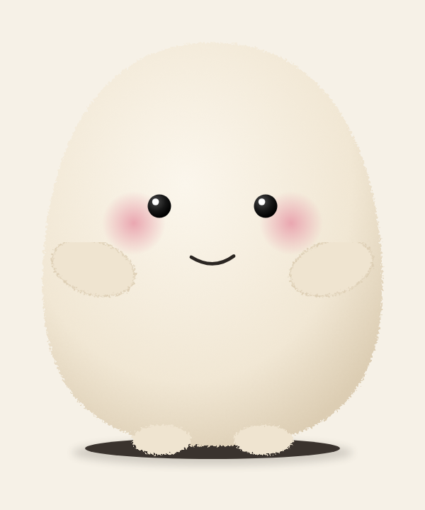

# Jolly-bot

A fluffy, bean-shaped tabletop social robot inspired by the Muse mascot: 3D-printed structure, six Dynamixel
servos, a sewn fur skin, and a Raspberry Pi running the animation engine. This repository holds the design,
the parametric CAD, the sourcing, and a web studio for designing the character's body language before any
hardware exists.

| | |
|---|---|
| Deck | [Jolly-bot Build Plan](https://claude.ai/artifact/JDVg1uWuHyqe3CGd1CPAHh), 22 slides with mocks (private artifact) |
| Studio | [Jolly-bot Character Studio](https://claude.ai/artifact/6ur9fH5UPHLU2P4xwLRcma), the live animation designer (private artifact); source in `character-studio/` |
| Plan | [`docs/plan/jolly-bot-plan.md`](docs/plan/jolly-bot-plan.md), the written plan after five critic rounds |
| CAD | [`cad/jollybot/`](cad/jollybot/), build123d model of every printed part, STEP/STL export, torque check |
| Parts | [`cad/jollybot/SOURCING.md`](cad/jollybot/SOURCING.md), per-store shopping list with prices and stock notes |

## What the robot is

- One cream fur bean, about 200 mm tall and 160 mm wide, beady eyes, pink cheeks, a stitched smile, two stubby arms.
- The whole body turns on a hidden floor disc; the top half pitches, rolls and bobs on a three-pushrod platform;
  the arms flap. Six XL330 servos, all on one bus, in current-based position mode so the robot yields when pushed.
- A printed two-half shell sized by one rule (skin envelope minus 22 mm), a 10 mm foam jacket, and a one-piece
  six-gore fur skin with a back zipper and threaded cabochon eyes.
- Pi Zero 2 W runs a 100 Hz animation engine and reflexes; a laptop runs perception and behaviour and sends intents.



## Layout

```
docs/plan/            written plan (final) and the five earlier revisions
docs/mocks/           character and mechanism mocks used in the deck; docs/art/ generates them
docs/renders/         shaded renders of the full CAD assembly with fasteners
cad/jollybot/         parametric CAD: params.py, parts/, build.py, render.py, analysis/torque_check.py, SOURCING.md
character-studio/     single-file three.js studio: line in, three body-language options out, pick into a bible
```

## Quick starts

```
# CAD: every part as STEP/STL plus line-drawing views
cd cad/jollybot && pip install -r requirements.txt && python3 build.py

# Torque and speed check against the current geometry
python3 analysis/torque_check.py

# Shaded renders (needs node + playwright + three, see render.js)
python3 render.py

# Mock drawings for the deck
cd ../.. && python3 docs/art/gen_mocks.py
```

Open `character-studio/index.html` in a browser to run the studio from the built-in motion library; published as
a claude.ai artifact it asks Claude for the moves and keeps the character bible.

## Hosting on Vercel

`vercel.json` serves `character-studio/` as the site and deploys `api/design.js` as a serverless function that
relays the studio's prompt to Claude with the official SDK (`@anthropic-ai/sdk`). Connect the repo to a Vercel
project, then set these environment variables in the project settings and redeploy:

| Variable | Required | Meaning |
|---|---|---|
| `ANTHROPIC_API_KEY` | yes, for generation | Without it the site still runs, but the Design button uses the built-in motion library |
| `STUDIO_PASSWORD` | recommended | A shared passcode the page asks for once per browser, so a public URL cannot spend your key |
| `STUDIO_MODEL` | no | Defaults to `claude-opus-5-5` |
| `STUDIO_EFFORT` | no | Defaults to `low`; raise to `medium` or `high` for more considered clips at the cost of latency |

On the hosted site the character bible and rounds are kept in the browser's local storage, and clips download
as plain JSON files.
